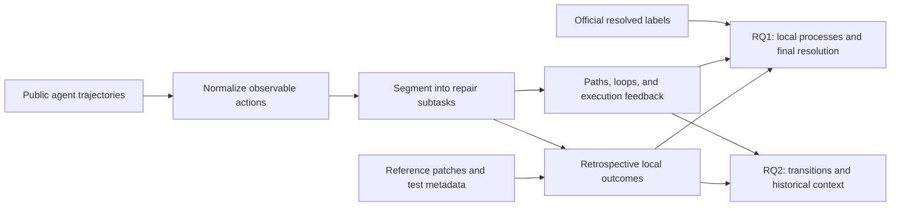

# How Software Agents Repair

**An empirical study of subtask outcomes, historical context, and feedback loops in agentic program repair.**

**Qiyang Li** · [GitHub](https://github.com/starry913) · [Website](https://starry913.github.io/)

Software agents can arrive at the same benchmark result through very different repair processes. A final success rate does not reveal where useful evidence emerges, how earlier localization informs later edits, or why repeated validation and refinement sometimes fail to produce a successful patch.

This project studies those process-level questions through **1,500 agent–instance trajectories** from **three agent systems** on **500 SWE-bench Verified tasks**, all using **Claude 4 Sonnet**. It develops an action-to-subtask representation, retrospective local-outcome annotations, and analyses of repair pathways, outcome discordance, and history-dependent transitions. The research contribution is the process representation and empirical analysis of existing public executions; agent inference and benchmark evaluation are supplied by the original submissions.

**Central observation:** repair trajectories retain information across subtask boundaries. The latest local label alone does not describe the agent's accumulated context, and oracle-relevant validation is distinct from an actual passing test.

[Research questions](#research-questions) · [Method](#method) · [Findings](#findings) · [Run the analyses](#run-the-analyses) · [Evidence and limitations](#evidence-and-limitations)

## Research questions

| Question | What is examined | Evidence |
| --- | --- | --- |
| **RQ1. How do local repair processes relate to final resolution?** | Local-outcome associations; subtask composition; pre-patch localization loops; post-patch refinement; disagreement between local and final outcomes. | [RQ1 report](RQ1/RQ1.md), [discordance analysis](RQ1/discordance/README.md), [loop analysis tables](RQ1/data/rq1_2/README.md) |
| **RQ2. How do local outcomes relate across subtasks?** | Adjacent reproduction–localization transitions; latest localization before the first patch; validation–refinement transitions; the role of earlier context and actual execution feedback. | [Current RQ2 report](RQ2/RQ2-pro.md), [recomputation script](RQ2/rq2_recompute.py), [sample-size audit](RQ2/data/pro/audit.csv) |

RQ1 connects process observations to the official final outcome. RQ2 examines local transitions without using the final `resolved` label. The current research release covers these two questions. `RQ3/` and `RQ4/` are reserved directories and contain no completed findings.

## Study design and dataset

The corpus holds the benchmark split and base-model identifier constant: **SWE-bench Verified** and `claude-4-sonnet-20250514`. Each selected system contributes one submission covering the same 500 instances. Agent architecture, tooling, budgets, and submission date can still differ; this is an observational comparison.

| Agent system | Submission | Agent–instance records | Official resolved |
| --- | --- | ---: | ---: |
| Lingxi v1.5 | `20250720_Lingxi-v1.5_claude-4-sonnet-20250514` | 500 | 373 / 500 (74.6%) |
| Moatless Tools | `20250611_moatless_claude-4-sonnet-20250514` | 500 | 354 / 500 (70.8%) |
| OpenHands | `20250524_openhands_claude_4_sonnet` | 500 | 352 / 500 (70.4%) |
| **Total** | | **1,500** | **1,079 / 1,500 (71.9%)** |

These are the selected submissions' recorded results, not a claim about current leaderboard rankings. Public execution artifacts and official outcomes come from [SWE-bench Experiments](https://github.com/SWE-bench/experiments); reference patches and test metadata come from [SWE-bench Verified](https://huggingface.co/datasets/princeton-nlp/SWE-bench_Verified). Exact submission identifiers and source URLs are retained in [agents.csv](swe_verified_claude4_traj/data/official/agents.csv).

The included analysis snapshot, `pre12_frfl_prdelta_reason2_outcome3`, contains:

- **155,836 action records** and **21,142 subtask records**.
- **1,491 complete repair trajectories**, defined by the presence of both patch construction and patch validation.
- **6,287** adjacent `FR → FL` transitions, **1,425** latest-`FL`/first-`PC` pairs, and **1,683** adjacent `PV → PR` transitions.
- Original public trajectories, normalized tables, reference metadata, reconstructed final patches, and case-level evidence.

See the [dataset report](pre/pre-12/metadata/pre12_report.md) and [RQ2 audit](RQ2/data/pro/audit.csv) for denominators. A trajectory, a subtask record, and a transition are different units of analysis; repeated events from one trajectory are not independent observations.

**Artifact status:** the table-based results below describe the included snapshot. RQ2 and the selected RQ1 summaries were recomputed exactly from that snapshot. A separate rebuild from raw logs with the current parser preserves counts and pathways but changes 319 local labels; execution-feedback findings are therefore snapshot-specific and provisional pending parser/snapshot reconciliation. See the [rebuild audit](docs/REPRODUCIBILITY.md) for the measured differences.

## Method



### 1. Represent actions and local repair goals

Observable actions are normalized into `Reason`, `Read`, `Search`, `Run`, `Add`, `Revise`, `Remove`, and `Setup`. Consecutive actions are grouped by their local repair goal:

| Code | Subtask | Operational meaning |
| --- | --- | --- |
| `PU` | Problem Understanding | Interpret the issue, expected behavior, and possible repair direction. |
| `FR` | Failure Reproduction | Obtain, construct, or inspect evidence of the target failure. |
| `FL` | Fault Localization | Identify source files, symbols, or logic relevant to the fault. |
| `PC` | Patch Construction | Construct the first candidate patch in product source code. |
| `PV` | Patch Validation | Execute or interpret tests and diagnostic checks on a candidate patch. |
| `PR` | Patch Refinement | Edit product source code again after a candidate patch and a validation event. |

The taxonomy tracks file provenance: creating or modifying a reproduction script is not automatically a product-code patch. Diagnostic and test-artifact edits belong to validation rather than refinement. The current dataset has **zero diagnostic-artifact records inside `PR`** and **zero `PR` records without a product-source edit**. Full boundary and labeling rules are in the [method specification](pre/pre-12/pre.md).

### 2. Separate three kinds of outcome

| Signal | Meaning | Available to the running agent? |
| --- | --- | --- |
| **Local outcome `+ / - / ?`** | Retrospective alignment with reference evidence under subtask-specific rules. `?` means insufficient evidence. | No: this analysis uses reference information after execution. |
| **Execution feedback** | Observed pass, fail, mixed, or unknown output from an executed check. | When retained in the trajectory. |
| **Final `resolved`** | The original submission's official benchmark outcome. | Used here as the final evaluation label. |

**`PV+` does not mean that tests passed.** It means that validation addressed oracle-relevant tests or behavior. Likewise, `PC+` or `PR+` is an alignment proxy, not proof that the patch is semantically correct. The analysis does not infer missing tool output from an agent's claim of success.

### 3. Analyze pathways, history, and evidence

RQ1 measures local-outcome associations, distinct subtask types, and two recurring transitions: `FR → FL` before a patch and `PV → PR` after a patch. It also examines reference-patch scope, marginal localization gains, first-patch status, and matched comparisons across agents on the same instance. Discordance analyses use one designated anchor per trajectory and subtask type to reduce repeated counting.

RQ2 combines adjacent transition tables with historical context. It pairs the first `PC` with the latest preceding `FL`, then checks whether an earlier localization had already exposed the eventual edit target. For validation and refinement, it separates oracle alignment from actual execution feedback and checks whether edits remain in existing source files.

Mechanism categories are operational evidence profiles. They support inspection of potential explanations; they do not establish causal mechanisms.

## Findings

### F1. First-patch alignment has the largest observed local-outcome gap

Across patch-construction records, the final resolution rate is **75.4% for `PC+`** (1,029 / 1,365) and **39.4% for `PC-`** (50 / 127), a **36.0 percentage-point** gap. This is larger than the corresponding positive–negative gaps for validation (12.5 points), refinement (9.3), understanding (9.1), localization (7.6), or reproduction (6.0).

The first implementation is a useful place to inspect why repair paths diverge. These are descriptive differences over subtask records, not a causal ranking of interventions; later refinement is observed in a selected subset of trajectories.

**Evidence:** [local-outcome counts](pre/pre-12/summary/pre12_local_outcomes.csv), [RQ1 analysis](RQ1/RQ1.md).

### F2. New localization gains concentrate in early loops

The proportion of `FR → FL` loop events that reach a new reference-relevant target falls from **60.2% in the first loop** to **37.9% in the second**, **6.1% in the third**, and **0.4% from the sixth onward**. Later loops more often revisit known targets or add no reference-file coverage.

This suggests studying stopping decisions based on incremental evidence, rather than treating loop count as progress. File coverage does not measure all useful reasoning: the result does not establish that every agent should stop after two loops.

**Evidence:** [marginal localization yield](RQ1/data/rq1_2/factors/marginal_localization_yield.csv), [factor analysis](RQ1/rq1_2_preloop_factor_analysis.py).

### F3. Longer post-patch loops are associated with lower resolution

Among complete repair trajectories, resolution decreases from **78.2% with no `PV → PR` loop** (949 trajectories) to **69.3% with one** (238) and **49.1% with five or more** (110). The pattern depends on first-patch status: for `PC-`, one refinement loop is associated with **53.3%** resolution versus **29.4%** without a loop; for `PC+`, the corresponding rates are **71.6%** versus **81.0%**.

Refinement can accompany recovery or prolonged difficulty. These groups differ in task difficulty and prior patch state, so the observed association does not show that extra edits cause failure.

**Evidence:** [RQ1 loop tables](RQ1/RQ1.md), [loop-depth data](RQ1/data/rq1_2/deep_loops/post_depth.csv).

### F4. Apparent recovery after reproduction misalignment often reuses earlier knowledge

Of **1,595 `FR- → FL+` transitions**, **60.3%** confirm a previously identified reference-relevant target. Another **31.5%** first localize through static context, while **7.3%** first localize after an execution in the current reproduction segment.

A negative local reproduction label does not erase context acquired earlier. An apparently successful next step need not represent recovery driven by the immediately preceding reproduction attempt.

**Evidence:** [transition mechanisms](RQ2/data/pro/rq21_fr_minus_fl_plus_mechanisms.csv), [current RQ2 report](RQ2/RQ2-pro.md).

### F5. The first patch often draws on the full localization history

Among **326 `FL- → PC+` pairs**, **86.8%** return to a target identified by an earlier positive localization. When the latest `FL` is negative, the share of `PC+` is **85.2% when an earlier `FL+` exists**, compared with **55.7% without one**.

The latest localization segment is an incomplete summary of the information available before patch construction. Retaining historical target exposure changes the interpretation of otherwise counterintuitive transitions.

**Evidence:** [patch-target mechanisms](RQ2/data/pro/rq22_fl_minus_pc_plus_mechanisms.csv), [history strata](RQ2/data/pro/rq22_fl_minus_history_strata.csv).

### F6. Relevant validation can still fail and prompt aligned refinement (snapshot-specific)

Of **271 `PV+ → PR+` transitions**, **72.0%** (195 / 271) have a last explicit validation feedback of failure, and **95.2%** continue editing existing product-source files. Across adjacent transitions, `PR+` occurs after **64.5% of `PV+`** and **61.8% of `PV-`** segments.

The offline validation label and the actual execution signal describe different things. These observations motivate separate modeling of test relevance, observed feedback, and the evolving patch. A sequence of local `+`/`-` labels alone cannot establish that patch quality improved or regressed. The exact feedback percentages depend on the stored outcome annotations and require revalidation after resolving the parser drift documented below.

**Evidence:** [feedback and refinement](RQ2/data/pro/rq23_pv_plus_feedback_to_pr.csv), [case-level mechanisms](RQ2/data/pro/rq23_pv_plus_pr_plus_mechanisms.csv), [current RQ2 interpretation](RQ2/RQ2-pro.md).

## Research implications

The findings motivate three testable directions for future agent design: retain localization evidence across subtask boundaries; measure the incremental value of another search or refinement step; and distinguish the scope of a validation check from its pass/fail result. **These are hypotheses for prospective evaluation.** This release does not claim a new repair agent, an intervention-induced performance improvement, or state-of-the-art benchmark results.

## Repository map

```text
.
├── README.md                         Research overview and evidence links
├── requirements.txt                  Validated analysis dependencies
├── docs/REPRODUCIBILITY.md            Verification results and known parser drift
├── scripts/verify_snapshot.py        Check the dataset and headline statistics
├── pre/pre-12/
│   ├── pre.md                        Taxonomy and annotation rules
│   ├── dataset/                      Actions, subtasks, and trajectories
│   ├── metadata/                     Reference metadata and corpus report
│   └── summary/                      Aggregated dataset statistics
├── RQ1/
│   ├── RQ1.md                        Local processes and final resolution
│   ├── *.py                          Analysis, audit, and existing test scripts
│   ├── data/rq1_2/                    Pathway and loop evidence
│   ├── audit/                        Execution and validation-scope audits
│   └── discordance/                  Cases and reconstructed final patches
├── RQ2/
│   ├── RQ2-pro.md                    Current history-aware RQ2 analysis
│   ├── rq2_recompute.py               Recompute current RQ2 tables
│   └── data/pro/                     Transition, mechanism, and audit tables
├── RQ3/ and RQ4/                     Reserved; no completed results
└── swe_verified_claude4_traj/
    ├── scripts/                      Original-data ingestion and abstraction
    └── data/
        ├── official/                 Submission metadata, labels, manifests
        ├── raw/                      Original public trajectory files
        └── processed/pre12/          Generated abstraction snapshot
```

**Reading order:** this overview → [method specification](pre/pre-12/pre.md) → [RQ1](RQ1/RQ1.md) → [current RQ2](RQ2/RQ2-pro.md) → linked case tables and scripts.

**Version note:** `RQ2/RQ2.md` retains an earlier analysis with different boundaries and counts. Use `RQ2/RQ2-pro.md` and `RQ2/data/pro/` for the current RQ2 results. The RQ1 `-pro`/`-ultra` documents and exploratory scripts preserve intermediate analyses; their interpretation should be checked against the specific linked data. The root README uses the current Pre-12 snapshot and names the evidence supporting each finding.

## Run the analyses

The repository includes the research datasets and raw public trajectories (approximately 1.3 GB uncompressed), so inspecting or recomputing the table-based analyses requires no model API key or agent execution.

### Check the included snapshot

From the repository root, using Python 3.10 or later:

```bash
python3 scripts/verify_snapshot.py
```

This uses only the Python standard library. It verifies corpus counts, official resolution labels, core-table consistency, refinement-boundary checks, current RQ2 sample sizes, and the headline statistics supported directly by the checked-in tables.

### Recompute RQ2 and selected RQ1 summaries

```bash
python3 RQ2/rq2_recompute.py
python3 RQ1/rq1_2_preloop_factor_analysis.py
python3 RQ1/rq1_2_deep_loop_analysis.py
python3 scripts/verify_snapshot.py
```

These commands use the included data and overwrite their generated CSV outputs. Reproducible analysis is part of the research artifact: these commands verify the measurements developed in this study.

### Install dependencies and run parser tests

```bash
python3 -m venv .venv
source .venv/bin/activate
python -m pip install -r requirements.txt
python -m unittest discover -s RQ1 -p 'test_*.py' -v
```

The existing tests cover execution-outcome parsing and extraction of final multi-file patches. They do not establish the semantic validity of all annotations.

### Regenerate the abstraction from raw trajectories

Full reference-based recomputation additionally needs the SWE-bench Verified reference Parquet file. Set `SWE_BENCH_VERIFIED_PARQUET` to a local copy, or use an existing Hugging Face cache for `princeton-nlp/SWE-bench_Verified`. Obtain the file from the [official dataset files](https://huggingface.co/datasets/princeton-nlp/SWE-bench_Verified/tree/main/data).

```bash
export SWE_BENCH_VERIFIED_PARQUET=/absolute/path/to/test-00000-of-00001.parquet
PRE12_OUT_DIR=/tmp/agent-repair-rebuild python swe_verified_claude4_traj/scripts/pre12_recompute.py
```

Outputs go to `swe_verified_claude4_traj/data/processed/pre12/` by default. **For this release, use a separate output directory:** the current parser does not reproduce all stored local labels. The curated `pre/pre-12/` snapshot remains the input to the RQ analyses.

The [rebuild audit](docs/REPRODUCIBILITY.md) records the differences observed in a full run. Replacing the frozen snapshot requires reviewing those label changes and recomputing downstream analyses together; the published findings must not be silently mixed with newly generated labels.

The raw files are already included. If any are missing, restore them from the recorded public manifests:

```bash
bash swe_verified_claude4_traj/scripts/download_raw_from_manifests.sh
```

For task-scope and deeper mechanism analyses, follow the [RQ1 data generation order](RQ1/data/rq1_2/README.md) after installing the dependencies and providing the reference dataset.

## Evidence and limitations

- **Observational scope.** One submission per system, one base-model family, and one benchmark split limit generalization. Task difficulty, agent configuration, and selection into refinement can confound aggregate comparisons.
- **Reference alignment is a proxy.** A valid alternative patch need not match the reference files or edit direction. File and lexical overlap do not establish semantic adequacy. Reference-based labels are retrospective and are not deployable online supervision without further work.
- **Uneven trace visibility.** The Lingxi public traces do not retain command stdout/stderr in the same way as other systems. Missing execution evidence is kept unknown rather than reconstructed from reasoning text.
- **Dependent observations.** Several events can belong to the same trajectory, and all agents share benchmark instances. Event-level percentages should not be interpreted as independent trial estimates. Matched analyses are included, but they do not remove every confounder.
- **Changing validation scope.** Consecutive validation subtasks may run different checks. A change in a `PV` alignment label is not necessarily a change in patch correctness.
- **Exploratory mechanisms.** Rule-derived categories and case studies support hypotheses. Manual semantic coding and prospective interventions remain necessary to assess stronger explanations. The included sampling artifacts do not imply that a complete inter-rater validation has been performed.
- **Parser/snapshot drift.** The current raw-log parser changes 319 of 21,142 local labels relative to the analysis snapshot. Exact raw-to-label reproducibility remains unresolved in this release, although the reported table-based recomputations are stable. Findings involving `FR`, `PR`, or actual feedback need sensitivity analysis on reconciled annotations.

## Attribution

Research analysis and repository maintained by **Qiyang Li** ([starry913](https://github.com/starry913)). The original agent runs, benchmark tasks, reference patches, and upstream code excerpts remain attributable to their respective authors. See the [submission provenance](swe_verified_claude4_traj/data/official/agents.csv), [SWE-bench Experiments](https://github.com/SWE-bench/experiments), and [SWE-bench Verified](https://huggingface.co/datasets/princeton-nlp/SWE-bench_Verified) for upstream sources. Inclusion here does not relicense third-party artifacts.

When referring to the analysis, include this repository's URL and the commit identifier so that the taxonomy, tables, and findings can be traced to a specific research snapshot.
